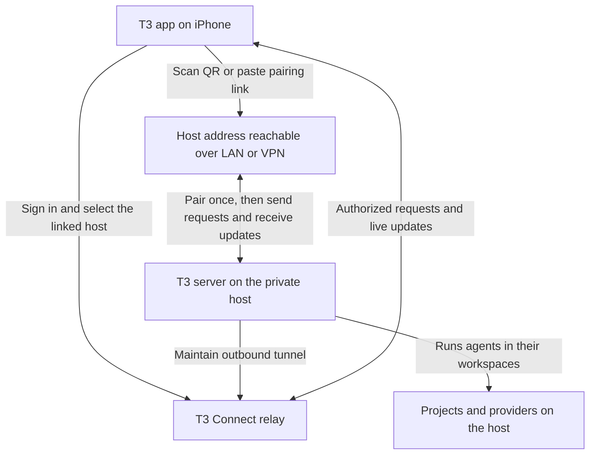

# How an iPhone connects to a private T3 server

The iPhone runs the T3 client. The T3 server on the Mac or private host keeps the projects and thread history, starts agents, and streams their responses. The host must keep running and be reachable over a paired route or T3 Connect.

For direct access, enable **Network access** on the host and create a pairing link using its LAN or VPN address. The phone exchanges the one-time code with that server, saves a device credential, and uses it on later connections. If the address is `localhost` or `127.0.0.1`, it points back to the phone. Use the server's reachable address instead. T3 Connect uses an outbound tunnel and a shared T3 Connect account when a direct route is unavailable. An optional approval step lets the host approve each new phone. [Remote access and pairing](../user/remote-access.md)

The server sends Antigravity usage and the context window over the existing connection. The iOS client reads that data for the active thread. To get both fixes, update the server and the client. Pairing again is unnecessary if the server keeps its identity and device credentials.

## When the iOS version changes

- Changing the server address, switching routes, or pairing again requires no app version change. An installed client can use a new server as long as the feature and protocol it needs are supported.
- A JavaScript-only client change can reach a compatible existing build through Expo Updates if updates are enabled and the channel and runtime version match. A development client can load the JavaScript from Metro. Preview and production builds use a native fingerprint to determine OTA compatibility.
- A change to native dependencies, entitlements, Associated Domains, or push configuration requires a new signed binary. Signing uses the build variant's bundle ID and a provisioning profile that covers the requested capabilities. A paid Apple Developer account allows issuing the appropriate profile. The app's marketing version does not fix a profile mismatch.
- For TestFlight or App Store uploads, the iOS build number must advance for a new upload. EAS manages the number remotely and increments it for the production and inherited TestFlight profiles. Change the marketing version when releasing a new version, since it is separate from the build number. [Mobile release procedure](./release.md#mobile-testflight-and-store-releases) · [Mobile configuration](../../apps/mobile/app.config.ts) · [EAS profiles](../../apps/mobile/eas.json)
